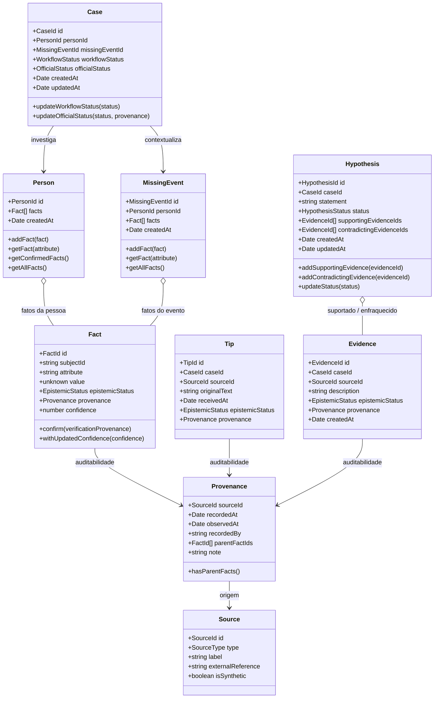

# Modelo Canônico de Domínio (Domain Model)

> **Documento:** `docs/DOMAIN_MODEL.md`  
> **Versão:** 1.0.0 (Gate 2 — Modelo Canônico de Domínio)

---

## 1. Visão Geral e Filosofia do Domínio

O núcleo de domínio (`src/domain/`) modela **conhecimento investigativo sob incerteza**, diferenciando categoricamente o que é fato observado, dado derivado, relato não verificado, hipótese analítica e simulação sintética.

O domínio é implementado em TypeScript estritamente puro, sem acoplamento com frameworks web, bancos de dados, ORMs ou bibliotecas externas.

---

## 2. Diagrama Conceitual de Entidades e Relacionamentos



---

## 3. Conceitos e Elementos do Domínio

### 3.1. Case (Agregado Raiz)
O agregado `Case` orquestra a investigação e mantém a separação mandatória entre:
- **`WorkflowStatus` (Estado Operacional Interno):** `DRAFT`, `ACTIVE`, `SUSPENDED`, `CLOSED`.
- **`OfficialStatus` (Estado Legal/Oficial Externo):** `OFFICIALLY_MISSING`, `OFFICIALLY_LOCATED`, `STATUS_TO_VERIFY`, `UNKNOWN`.
- *Invariante:* A ativação ou fechamento de um caso interno na plataforma **não altera** o status legal do desaparecimento perante os órgãos de segurança pública sem prova e proveniência formal.

### 3.2. Person (Identidade Investigativa)
Representa a pessoa sob investigação.
- **Tolerância a Lacunas:** Não exige dados cadastrais rígidos (como CPF, RG ou nome completo obrigatórios).
- Permite construir a identidade de forma incremental conforme fatos são agregados.

### 3.3. MissingEvent (Evento de Desaparecimento)
Representa o contexto circunstancial, temporal e espacial do desaparecimento.
- Admite ausência parcial ou total de datas ou locais no início da apuração.

### 3.4. Fact e Provenance
A menor unidade de conhecimento no sistema.
- Cada `Fact` possui um `subjectId`, `attribute`, `value`, `epistemicStatus`, `provenance` e um `confidence` opcional.
- O campo `confidence` varia estritamente de `0.0` a `1.0` e expressa a precisão técnica da captura/fonte — **nunca** promovendo o status epistêmico de forma autônoma.
- `Provenance` registra: `sourceId`, `recordedAt` (entrada no sistema), `observedAt` (quando ocorreu), `recordedBy` (responsável pelo registro), `parentFactIds` (fatos ancestrais em derivações) e `note`.

### 3.5. Source
A origem de uma informação com tipagem semântica explícita (`OFFICIAL_RECORD`, `LAW_ENFORCEMENT`, `HEALTH_INSTITUTION`, `SOCIAL_ASSISTANCE`, `NGO`, `FAMILY`, `AUTHENTICATED_CITIZEN`, `ANONYMOUS_REPORT`, `SYSTEM_DERIVATION`, `SYNTHETIC_TEST`).
- Fontes marcadas como `SYNTHETIC_TEST` forçam `isSynthetic = true`.

### 3.6. Tip (Pistas e Relatos)
Representa relatos espontâneos recebidos de cidadãos, informantes ou canais públicos.
- **Texto Original Intocado:** O texto bruto é preservado integralmente para garantir valor forense.
- **Status Inicial UNVERIFIED:** Nenhuma pista entra no sistema como `CONFIRMED`.

### 3.7. Evidence (Evidências)
Registros de material probatório ou achados documentados.
- **Existência vs. Interpretação:** A evidência registra a existência de um elemento de suporte (ex: atendimento hospitalar, registro de bilhetagem); sua vinculação como suporte ou enfraquecimento de uma hipótese é feita na entidade `Hypothesis`.

### 3.8. Hypothesis (Hipóteses Investigativas)
Proposições analíticas sobre o caso (`OPEN`, `SUPPORTED`, `WEAKENED`, `REJECTED`, `RESOLVED`).
- **Invariante Fundamental:** Uma `Hypothesis` **NUNCA** é convertida em um `Fact` confirmado. O aumento de suporte ou evidências correlacionadas altera o status da hipótese para `SUPPORTED`, mas fatos confirmados exigem validação e proveniência formal de fonte adequada.

---

## 4. Estados Epistêmicos e Invariantes

```
+---------------+     verificação com fonte adequada     +---------------+
|  UNVERIFIED   | -------------------------------------> |   CONFIRMED   |
+---------------+                                        +---------------+
        |
        | derivação determinística (com parentFactIds)
        v
+---------------+
|    DERIVED    |
+---------------+

+---------------+                                        +---------------+
|   SYNTHETIC   | --[ PROIBIDO PROMOVER SILENCIOSAMENTE ]-> |   CONFIRMED   |
+---------------+                                        +---------------+

+---------------+                                        +---------------+
|  HYPOTHESIS   | --[ PROIBIDO TRANSFORMAR DIRETO EM ]---> |   CONFIRMED   |
+---------------+                                        +---------------+
```

1. **`SYNTHETIC` jamais vira `CONFIRMED`:** Garante que dados de simulação e benchmarks não contaminem bases reais.
2. **`HYPOTHESIS` não vira `CONFIRMED`:** A hipótese articula evidências, mas não se confunde com um fato comprovado.
3. **`DERIVED` exige rastreabilidade:** Fatos calculados devem apontar para seus fatos geradores (`parentFactIds`).
4. **Ausência de Informação ≠ Contradição:** A ausência de um atributo significa "não sabemos" (neutro), enquanto divergência excludente é classificada como contradição (`SOFT` ou `HARD`).