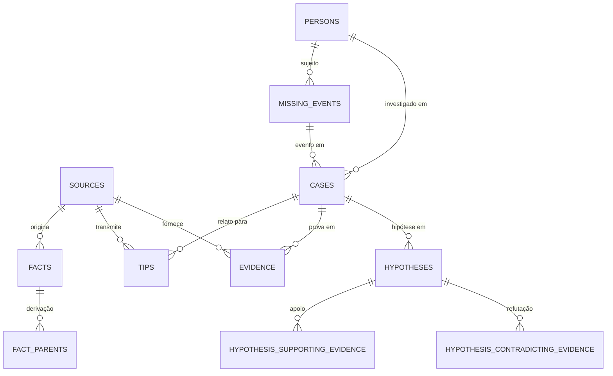

# Infraestrutura de Persistência (SQLite Local)

> **Documento:** `docs/PERSISTENCE.md`  
> **Versão:** 1.0.0 (Gate 4 — Persistência SQLite Local)

---

## 1. Por que SQLite para o MVP Local?

A escolha do **SQLite** (via driver nativo síncrono/assíncrono `better-sqlite3`) para o MVP inicial baseia-se em princípios de simplicidade operacional e agilidade de desenvolvimento:
- **Zero Configuração de Servidor:** Execução direta no arquivo local (`data/busca-ia.db`), sem necessidade de Docker ou daemon de banco rodando em background.
- **Isolamento Completo para Testes:** Permite executar suites de teste em milissegundos usando `:memory:` ou arquivos temporários isolados no sistema operacional.
- **Integridade Relacional Real:** Suporte completo a chaves estrangeiras (`PRAGMA foreign_keys = ON`), transações ACID e `WAL mode` (`PRAGMA journal_mode = WAL`).
- **Determinismo:** Comportamento reproduzível em qualquer ambiente de desenvolvimento local (Windows, macOS, Linux).

---

## 2. Papel da Camada de Infraestrutura

A camada `src/infrastructure/` atua estritamente como **adaptador de saída** (Output Adapter no modelo Hexagonal).

```
       +-------------------------------------------------------+
       |             Presentation (src/app, components)        |
       +-------------------------------------------------------+
                                  |
                                  v
       +-------------------------------------------------------+
       |        Application Use Cases (src/application)        |
       +-------------------------------------------------------+
                                  |
                                  v
       +-------------------------------------------------------+
       |               Domain (src/domain) [PURO]              |
       +-------------------------------------------------------+
                                  |
                                  v
       +-------------------------------------------------------+
       |             Ports (src/application/ports)             |
       +-------------------------------------------------------+
                                  ^
                                  | (implementa contratos de porta)
       +-------------------------------------------------------+
       |             Infrastructure (src/infrastructure)       |
       |             - SQLite Repositories & Mappers           |
       +-------------------------------------------------------+
                                  |
                                  v
       +-------------------------------------------------------+
       |                  data/busca-ia.db                     |
       +-------------------------------------------------------+
```

### Inversão de Dependência
- `src/domain/` e `src/application/` **NÃO conhecem** SQLite, better-sqlite3 ou SQL.
- A Infraestrutura importa os contratos de `src/application/ports/` e os modelos de `src/domain/` para traduzir entre linhas do banco (`Row`) e instâncias de domínio (`Entity`).

---

## 3. Schema Relacional e Migrations

As tabelas são gerenciadas por um mecanismo de migrações versionadas e idempotentes com rastreamento na tabela `schema_migrations`:



### 3.1. Tabelas Principais
- `sources`: Origens e canais de informação (institucionais, cidadãos, sintéticos).
- `persons`: Identidades investigativas com integridade referencial.
- `missing_events`: Contexto e circunstâncias do desaparecimento vinculados à pessoa.
- `cases`: Agregado investigativo principal, segregando `workflow_status` e `official_status`.
- `facts`: Fatos atômicos com `value_json`, proveniência completa e `confidence`.
- `fact_parents`: Tabela associativa relacional para rastreabilidade de fatos derivados (`parent_fact_id`).
- `tips`: Relatos e pistas recebidos, preservando o `original_text` verbatim.
- `evidence`: Elementos probatórios documentados de forma independente.
- `hypotheses`: Hipóteses investigativas com status analítico.
- `hypothesis_supporting_evidence` / `hypothesis_contradicting_evidence`: Tabelas associativas de suporte e refutação probatória.

---

## 4. Mappers e Estratégia de Serialização

Cada entidade possui um mapper dedicado em `src/infrastructure/persistence/sqlite/mappers/`:
- **Tradução Pura:** Mappers convertem linhas de storage em objetos de domínio imutáveis e vice-versa.
- **Tipagem Segura:** Reconstituição de branded types (`CaseId`, `PersonId`, etc.), datas ISO e enums.
- **Valores Heterogêneos de Fatos:** O campo `value` de `Fact` é serializado como `value_json` em coluna `TEXT`, preservando números, strings e estruturas aninhadas sem perda de tipo.
- **Preservação de Ausência:** Valores ausentes (`undefined`/`null`) nunca são coagidos a valores fictícios ou datas padrão.

---

## 5. Limites Transacionais (Transactions)

Gravações que envolvem tabelas relacionais associativas são executadas em **transações atômicas**:
- `SqliteFactRepository.save`: Grava linha em `facts` e sincroniza entradas em `fact_parents` em uma única transação.
- `SqliteHypothesisRepository.save`: Grava linha em `hypotheses` e sincroniza entradas em `hypothesis_supporting_evidence` e `hypothesis_contradicting_evidence` atomicamente.

---

## 6. Configuração e Variáveis de Ambiente

O caminho do arquivo do banco de dados pode ser configurado via variável de ambiente:
- **`BUSCAIA_DB_PATH`**: Caminho relativo ou absoluto para o arquivo SQLite (Padrão: `./data/busca-ia.db`).
- **Testes:** Usam `:memory:` ou arquivos temporários dedicados via `os.tmpdir()`.
- **Governança:** Arquivos `.db`, `.sqlite` e `.sqlite3` são expressamente excluídos pelo `.gitignore` e jamais são commitados.

---

## 7. Limitações do SQLite e Estratégia de Evolução Futura

- **Concorrência Local:** SQLite opera com modelo single-writer/multiple-readers. Para ambientes de produção com múltiplos nós de aplicação e escrita concorrente massiva, um banco relacional cliente-servidor (PostgreSQL) será introduzido.
- **Migração Transparente:** Como todos os casos de uso dependem exclusivamente das interfaces assíncronas em `src/application/ports/`, a migração para PostgreSQL consistirá na criação de novos adaptadores em `src/infrastructure/persistence/postgres/`, **sem alterar uma única linha do Domain ou da Application**.